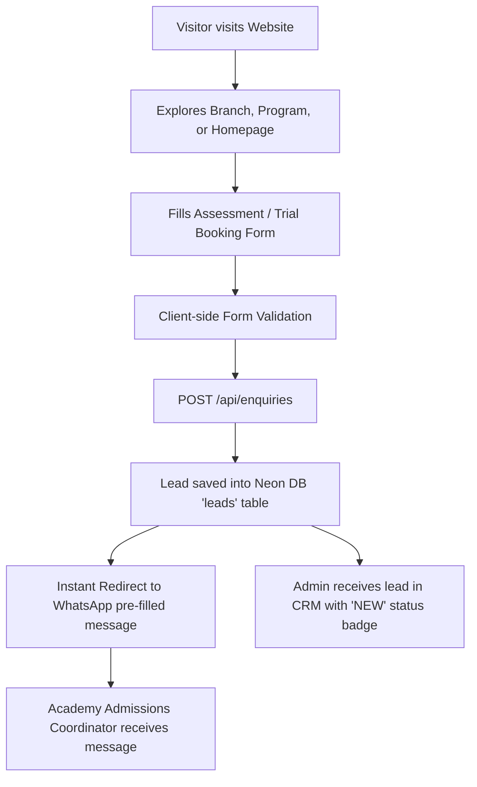
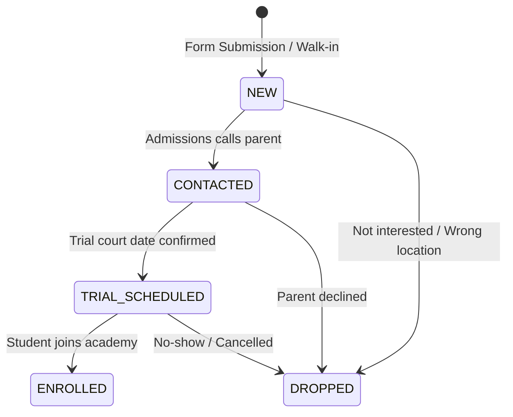
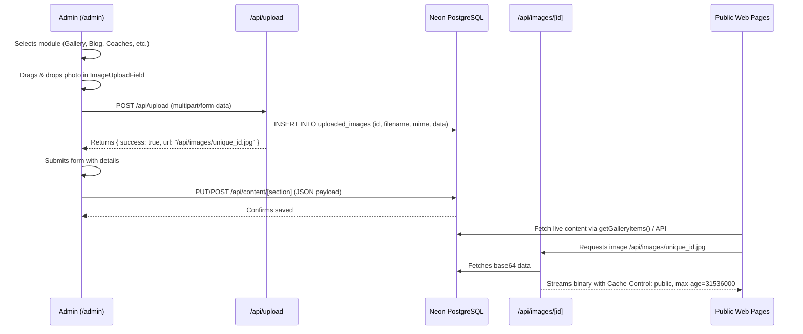

# S & A BADMINTON ACADEMY — COMPLETE SYSTEM & SECTION DOCUMENTATION
**Document Version:** 3.0 (Production Master)  
**Last Updated:** September 2026  
**Status:** Live & Deployed (`https://soorajbadmintonacademy.vercel.app`)  
**Repository:** `https://github.com/nibrasul/SOORAJBADMINTONACADEMY` (`main` branch)

---

## 1. EXECUTIVE OVERVIEW & CURRENT STAGE

### 1.1 Project Mission
S & A Badminton Academy is a high-performance badminton training institution based in Kochi, Kerala, operating international-standard indoor facilities across Kadavanthra, Edappally, and Kakkanad. 

The website serves three core business functions:
1. **Brand Positioning ("Rebel Performance")**: An editorial sports campaign aesthetic inspired by Nike Training and Red Bull, rejecting generic academy templates in favor of cinematic typography, high-contrast imagery, and athletic discipline.
2. **Admissions & Conversion Funnel**: Converting prospective parents, junior athletes, and adult players into enrolled students through structured curriculum presentations, WhatsApp trial bookings, and automated lead capture.
3. **Internal Operations & Content Studio**: A fully isolated Admin Portal featuring a real-time Admissions CRM and a dynamic CMS backed by **Neon Serverless PostgreSQL** to update website content (Gallery, Blog, Coaches, Track Record, and Reviews) and direct image uploads without requiring code deployments.

---

### 1.2 Technology Stack

| Layer | Technology | Purpose / Configuration |
|---|---|---|
| **Framework** | Next.js 16.3.4 (App Router) | Server-side rendering (SSR), Static Site Generation (SSG), Turbopack compilation |
| **Language** | TypeScript 5.x | Strict type safety across all database models, API payloads, and UI components |
| **Styling** | Vanilla Tailwind CSS | Dark athletic campaign palette (`#07090D` deep black, `#B8F000` acid lime, `#1F2937` borders) |
| **Database** | Neon PostgreSQL | Cloud-native serverless PostgreSQL with connection pooling (`@neondatabase/serverless`) |
| **Hosting & CDN**| Vercel Serverless Edge | Edge caching, automated GitHub deployments, global CDN distribution |
| **Icons & UI** | Lucide React | Clean, scalable athletic iconography |
| **Media Handling**| Neon DB Binary Storage | Base64 binary persistence in Neon DB streamed via cached edge route `/api/images/[id]` |

---

### 1.3 Current Project Stage
- **Phase 1 (Technical Handover & Full Audit)**: Completed (19 individual audit reports in `documentation/`).
- **Phase 2 (Visual Redesign & Brand Transformation)**: Completed (Rebel Performance aesthetic deployed across all 35 routes).
- **Phase 3 (Admissions CRM & Neon DB Integration)**: Completed (Live lead tracking, Kanban pipeline, table, analytics, and CSV export).
- **Phase 4 (Dynamic Website CMS & Image Uploads)**: Completed (Live management of Gallery, Blog, Coaches, Track Record, and Reviews with direct image file upload and Neon DB persistence).
- **Phase 5 (Centre Photo Gallery Rollout)**: Completed (Interactive Centre Photo Gallery with Lightbox embedded across all branch and program landing pages).

---

## 2. CORE WORKFLOWS & USER PROCESSES

### 2.1 The Lead Conversion & WhatsApp Dispatch Workflow



1. **User Action**: The visitor completes an enquiry form on the homepage, a branch page (`/kadavanthra`), a program page (`/programs/junior-badminton-coaching`), or `/contact`.
2. **Data Processing**: Form fields (Student Name, Phone, Email, Branch, Program, Preferred Slot, Age Category, Message) are validated client-side.
3. **Parallel Persistence & Dispatch**:
   - The enquiry is sent via `POST /api/enquiries` to the database, where it is timestamped, assigned a unique ID, and given the initial status `NEW`.
   - The user is seamlessly forwarded to WhatsApp via `buildWhatsAppUrl()` with an auto-formatted message:
     ```
     "Hi S&A Academy! I would like to book a free assessment session.
     Name: Arjun Kumar
     Phone: +91 98460 00000
     Branch: Kadavanthra (Central Kochi)
     Program: Junior Coaching
     Slot: Evening Batch"
     ```
4. **Instant CRM Visibility**: The admissions team immediately sees the lead in the `/admin` Kanban board with real-time status indicators.

---

### 2.2 Admissions CRM Stage Progression



- **NEW**: Inbound enquiry just received from website or manual walk-in entry.
- **CONTACTED**: Admissions team has engaged the student/parent via phone or WhatsApp.
- **TRIAL_SCHEDULED**: Free on-court skill assessment date and branch assigned.
- **ENROLLED**: Student has paid fees and started coaching curriculum.
- **DROPPED**: Candidate disqualified, out of transit radius, or inactive.

---

### 2.3 Dynamic Content Management (CMS) & Image Upload Process



---

## 3. DETAILED BREAKDOWN OF ALL WEBSITE SECTIONS

### 3.1 Global Elements & Layout Architecture

#### `AppLayoutWrapper.tsx`
- **Isolation Logic**: Checks the current pathname. If `pathname.startsWith("/admin")`, it suppresses the public website `AnnouncementBanner`, `Navbar`, `MobileConversionBar`, and `Footer`.
- **Full Viewport**: Gives the `/admin` portal 100% full-height viewport real estate with zero consumer navigation interference.

#### `Navbar.tsx`
- **Design Tokens**: Solid athletic black `#07090D` with top 1px border `#1F2937`.
- **Navigation Links**:
  - `Programs`: Hover dropdown featuring Kids, Junior, Adult, Competitive, and Camps.
  - `Centres`: Quick selector for Kadavanthra, Edappally, Kakkanad, and Fourth Centre.
  - `Coaches`: Direct link to faculty profiles.
  - `Track Record`: Direct link to tournament achievements.
  - `Reviews`: Verified testimonials.
  - `Gallery`: Photo archive with centre filtering.
  - `Blog`: Articles and player development guides.
  - `Contact`: Primary conversion action button with acid lime highlight (`#B8F000`).

#### `MobileConversionBar.tsx`
- **Sticky Conversion Strip**: Fixed at bottom of mobile viewports (`z-40`).
- **Direct Actions**:
  - `Call Academy`: Direct tel prompt to `+91 94477 96222`.
  - `WhatsApp`: Pre-filled chat launch.
  - `Book Free Trial`: Anchor scroll to enquiry form.

#### `Footer.tsx`
- **Four-Column Structure**:
  1. Brand manifesto, BWF Grade-1 certifications, affiliation badges.
  2. Quick navigation links & developmental tracks.
  3. Centre directory with physical addresses and direct Google Maps pins.
  4. Operational hours, customer care telephone, and WhatsApp hotline.

---

### 3.2 Page 1: Homepage (`app/page.tsx`)

| Section | Component | Description & Functionality |
|---|---|---|
| **01. Hero Campaign** | `HeroSection.tsx` | High-impact full-viewport intro featuring cinematic badminton athlete imagery, athletic typography, dynamic stat badges (4 Centres, 18+ Coaches, 500+ Active Athletes), and dual CTAs. |
| **02. Rebel Manifesto** | In-page | Bold typography statement defining the academy's coaching philosophy: discipline, footwork biomechanics, and tournament excellence. |
| **03. Program Experience** | `ProgramsSection.tsx` | Interactive 4-card pathway grid (Kids Foundation, Junior Development, Adult Fitness, Tournament Elite) with age tags, weekly schedules, and curriculum breakdown. |
| **04. Kochi Centres Infrastructure** | In-page | Grid highlighting Kadavanthra (HQ), Edappally, and Kakkanad with court counts, flooring specs, and directions. |
| **05. Coaching Spotlight** | `CoachesSpotlight.tsx` | Live profiles of senior coaches (Anand Varma, Priya Nair, etc.) loaded dynamically from Neon DB via `getCoaches()`. |
| **06. Training Methodology** | In-page | 4-pillar athletic breakdown: Biomechanics & Grip, Footwork Agility, Match Tactics & Video Analysis, Conditioning & Nutrition. |
| **07. Track Record Archive** | `AchievementsSection.tsx` | Tournament victories and state medals loaded dynamically from Neon DB via `getAchievements()`, with medal ribbons, athlete names, and podium photos. |
| **08. Court Visuals Gallery** | `GalleryPreview.tsx` | Curated live court action shots with hover zoom and direct link to `/gallery`. |
| **09. Parent & Student Reviews** | `TestimonialsSection.tsx` | Verified reviews with 5-star ratings, quotes, and parent credentials loaded dynamically via `getTestimonials()`. |
| **10. FAQ Accordion** | In-page | Schema.org JSON-LD backed answers to key questions (age criteria, racket requirements, fee structures). |
| **11. Final Conversion CTA** | `FinalCTA.tsx` | Full-width high-contrast conversion banner with direct WhatsApp dispatch. |

---

### 3.3 Page 2: Dedicated Centre Landing Pages (`app/[location]/page.tsx`)

**Routes:** `/kadavanthra`, `/edappally`, `/kakkanad`, `/fourth-centre`

Each centre has a dedicated SEO-optimized landing page featuring:
1. **Centre Hero Banner**: Headline, exact address, contact phone, operating hours (05:00 AM – 10:30 PM), and Google Maps direction button.
2. **Infrastructure Metric Strip**: Number of BWF Grade-1 courts, flooring type (imported teak wood with 4.5mm vinyl synthetic rubber mats), lighting lux level (750 Lux glare-free overhead LED).
3. **Batch Timings Table**: Morning junior batches, evening competitive squads, and night adult corporate slots.
4. **Programs Available at This Centre**: Filtered developmental programs running at this specific facility.
5. **Centre Facilities Checklist**: Changing rooms, shower facilities, parent viewing gallery, pro shop stringing, RO water stations, parking.
6. **Centre Photo Gallery (`CentreGallerySection.tsx`)**: An interactive photo showcase displaying real photos of this specific centre's courts, lighting, and training drills, with full-screen lightbox.
7. **Local Coaching Faculty**: Head coaches and trainers assigned to this centre.
8. **Interactive Google Maps & Directions**: Direct transit links.
9. **Centre FAQs & Structured Data**: `LocalBusiness` and `SportsActivityLocation` Schema.org JSON-LD.

---

### 3.4 Page 3: Centres Directory (`app/branches/page.tsx`)

- **Purpose**: High-level overview of the entire academy network across Kochi.
- **Features**:
  - Detailed directory cards for each centre with court counts, full addresses, directions, and phone hotlines.
  - **Centres & Courts Gallery (`CentreGallerySection.tsx`)**: Visual tour of facilities across Kadavanthra, Edappally, and Kakkanad.
  - Internal links to dedicated sub-pages (`/kadavanthra`, `/edappally`, etc.).

---

### 3.5 Page 4: Programs Directory (`app/programs/page.tsx`) & Program Detail Pages (`app/programs/[slug]/page.tsx`)

**Routes:**
- `/programs/kids-badminton-coaching` (Ages 5–9)
- `/programs/junior-badminton-coaching` (Ages 10–16)
- `/programs/adult-badminton-coaching` (Ages 17+)
- `/programs/holiday-badminton-camp-kochi` (Seasonal intensive)
- `/programs/private-badminton-coaching` (1-on-1 performance)

**Program Detail Page Elements:**
1. **Hero Header**: Program title, target age badge, skill level, and batch schedule.
2. **Syllabus & Athletic Milestones**: 12-week progression modules covering grip foundations, footwork drills, smash mechanics, and match play.
3. **Training Courts & Arena Gallery (`CentreGallerySection.tsx`)**: Displays actual courts and training facilities where the program takes place.
4. **Sticky Booking Drawer / Form**: Allows immediate trial assessment booking without leaving the curriculum.
5. **Related Pathways**: Cross-links to complementary developmental tracks.

---

### 3.6 Page 5: Coaching Faculty (`app/coaches/page.tsx`)

- **Data Source**: Fetches dynamically from Neon PostgreSQL via `getCoaches()`.
- **Card Elements**:
  - Coach square portrait headshot (stored and streamed from Neon DB).
  - Coaching role (Head Coach, Senior High-Performance Coach, Junior Development Lead).
  - Primary branch assignment.
  - Certifications list (BWF Level 1 & 2, NIS Diploma in Sports Coaching).
  - Career achievements (Former state champions, national qualifiers coached).
  - Coaching philosophy quote.

---

### 3.7 Page 6: Tournament Track Record (`app/achievements/page.tsx`)

- **Data Source**: Fetches dynamically from Neon PostgreSQL via `getAchievements()`.
- **Elements**:
  - Chronological timeline organized by year (2024, 2023, 2022).
  - Medal badge ribbon (Gold & Silver Medals, Best Academy Trophy, National Ranking).
  - Category tags (State Championship, District Title, National Qualification, Academy Milestone).
  - Athlete/team names and comprehensive victory descriptions.
  - **Podium & Trophy Photos**: High-res photos uploaded via the Admin CMS.

---

### 3.8 Page 7: Parent & Player Reviews (`app/testimonials/page.tsx`)

- **Data Source**: Fetches dynamically from Neon PostgreSQL via `getTestimonials()`.
- **Elements**:
  - Star rating display (1 to 5 stars).
  - Reviewer identity, child name, and age category.
  - Branch location badge (`Kadavanthra Branch`, `Edappally Branch`, etc.).
  - Pull-quote highlights and detailed parent testimonials.

---

### 3.9 Page 8: Blog Hub (`app/blog/page.tsx`) & Articles (`app/blog/[slug]/page.tsx`)

- **Data Source**: Fetches dynamically from Neon PostgreSQL via `getBlogPosts()`.
- **Article Page Features**:
  - Featured cover image (uploaded via Admin CMS).
  - Publication date, author badge, and estimated reading time.
  - Category tags (e.g. `Badminton Footwork`, `Kids Fitness`, `Beginner Guide`).
  - Full article body editor supporting markdown headings, bullet points, and training guides.
  - Social sharing links and trial booking CTA banner.

---

### 3.10 Page 9: Central Photo Gallery (`app/gallery/page.tsx`)

- **Interactive Features (`GalleryInteractive.tsx`)**:
  - **Centre Selector Strip**: Filter by `All Centres`, `Kadavanthra`, `Edappally`, or `Kakkanad`.
  - **Category Pills**: Filter by `Courts & Arena`, `Training Drills`, `Tournaments`, `Juniors & Camps`, `Coaching Sessions`.
  - **Full-Screen Lightbox**: Clicking any photo opens the interactive modal with Next/Previous buttons, captions, and branch tags.
  - **Dynamic Ingestion**: Pulls photos directly from Neon PostgreSQL (`/api/content/gallery`).

---

### 3.11 Page 10: Assessment Booking & Contact (`app/contact/page.tsx`)

- **Features**:
  - Direct branch phone hotlines and operational hours.
  - Interactive Enquiry Form with real-time feedback.
  - Pre-selection support via URL query parameters (e.g. `/contact?branch=edappally&program=kids-badminton-coaching`).
  - Automatic lead insertion into Neon DB followed by WhatsApp dispatch.

---

### 3.12 Page 11: Admin Control Center & Admissions CRM (`app/admin/page.tsx`)

- **Security**: PIN authentication screen (Default PIN: `1234`), session persistence via `sessionStorage`.
- **Isolated Layout**: Public navigation, header banners, and footer are completely disabled on `/admin`.
- **Top Sub-Navigation Bar**:
  - 🎯 **Admissions CRM**
  - 📸 **Gallery**
  - 📰 **Blog Articles**
  - 🏸 **Coaches**
  - 🏆 **Track Record**
  - ⭐ **Reviews**

#### Detailed Admin Sub-Modules:

| Sub-Module | Primary Capabilities |
|---|---|
| **Admissions CRM** | Kanban Pipeline with drag/advance buttons, sortable Table view, Analytics dashboard with conversion rates, CSV export, and Slide-over Lead Detail Drawer for note-taking and candidate editing. |
| **Gallery CMS** | Add, edit, and delete photos. Uses `ImageUploadField` for direct computer/phone photo uploads, branch assignment, category tags, and captions. |
| **Blog CMS** | Draft, edit, and publish articles. Auto-slug generator, author attribution, cover photo upload, tags, and full Markdown body editing. |
| **Coaches CMS** | Manage coaching faculty profiles, headshot photo upload, BWF certifications, career milestones, and bio quotes. |
| **Track Record CMS** | Add tournament victories, medals won, year, athlete names, category tags, and podium/trophy photo uploads. |
| **Reviews CMS** | Manage parent testimonials, 1-5 star selector, branch attribution, quote highlights, and full feedback text. |

---

## 4. DATABASE SCHEMA & BACKEND API SPECIFICATION

### 4.1 Neon PostgreSQL Tables

#### Table 1: `leads` (Admissions Pipeline)
```sql
CREATE TABLE IF NOT EXISTS leads (
  id VARCHAR(64) PRIMARY KEY,
  name VARCHAR(255) NOT NULL,
  phone VARCHAR(64) NOT NULL,
  email VARCHAR(255),
  branch VARCHAR(64) NOT NULL,
  program VARCHAR(128) NOT NULL,
  slot VARCHAR(128) NOT NULL,
  age_category VARCHAR(64),
  status VARCHAR(32) NOT NULL DEFAULT 'NEW',
  message TEXT,
  source VARCHAR(64) DEFAULT 'website_form',
  notes TEXT,
  created_at TIMESTAMPTZ DEFAULT NOW(),
  updated_at TIMESTAMPTZ DEFAULT NOW()
);
```

#### Table 2: `site_content` (Dynamic CMS Payload Store)
```sql
CREATE TABLE IF NOT EXISTS site_content (
  section VARCHAR(64) PRIMARY KEY,
  data JSONB NOT NULL,
  updated_at TIMESTAMPTZ DEFAULT NOW()
);
```
*Sections stored:* `gallery`, `blog`, `coaches`, `achievements`, `testimonials`.

#### Table 3: `uploaded_images` (Serverless Media Storage)
```sql
CREATE TABLE IF NOT EXISTS uploaded_images (
  id VARCHAR(64) PRIMARY KEY,
  filename VARCHAR(255) NOT NULL,
  mime_type VARCHAR(64) NOT NULL,
  data TEXT NOT NULL,
  size INTEGER NOT NULL,
  created_at TIMESTAMPTZ DEFAULT NOW()
);
```

---

### 4.2 REST API Endpoints

#### 1. Leads API: `/api/enquiries`
- `GET`: Returns list of all leads sorted by `created_at DESC`.
- `POST`: Adds a new lead (used by contact forms and admin manual lead entry).
- `PATCH`: Updates lead status (`status`), notes (`notes`), or candidate details.
- `DELETE`: Permanently deletes a lead by `id`.

#### 2. Content CMS API: `/api/content/[section]`
- `GET`: Returns `{ success: true, section, total, items: [...] }`.
- `POST`: Adds a new item to the section, automatically assigning a unique ID/slug.
- `PUT`: Updates an existing item matching `id` or `slug`.
- `DELETE`: Removes an item by `?id=...` or `?slug=...`.

#### 3. Image Upload API: `/api/upload`
- `POST`: Accepts `multipart/form-data` with `file`.
- Validates file type (JPG, PNG, WebP, GIF, SVG, AVIF) and size (< 10MB).
- Converts binary buffer to base64 string and inserts into `uploaded_images` in Neon DB.
- Returns `{ success: true, url: "/api/images/[unique_id]" }`.

#### 4. Image Serving API: `/api/images/[id]`
- `GET`: Fetches base64 data from `uploaded_images` by `id`.
- Decodes buffer and streams binary with HTTP headers:
  - `Content-Type: image/jpeg` (or matching mime)
  - `Cache-Control: public, max-age=31536000, immutable`
- Automatically cached by Vercel Edge CDN.

---

## 5. REPOSITORY DIRECTORY MAP

```
S-A-BADMINTON-ACADEMY/
├── app/
│   ├── [location]/page.tsx             # 4 Centre landing pages (Kadavanthra, Edappally, etc.)
│   ├── about/page.tsx                  # Academy heritage & coaching methodology
│   ├── achievements/page.tsx           # Tournament medals & achievements timeline
│   ├── admin/page.tsx                  # Isolated Admin Portal (CRM + CMS Studio)
│   ├── api/
│   │   ├── content/[section]/route.ts  # Dynamic CMS CRUD endpoint
│   │   ├── enquiries/route.ts          # Admissions lead pipeline endpoint
│   │   ├── images/[id]/route.ts        # Edge cached image streaming route
│   │   └── upload/route.ts             # Direct image file upload to Neon DB
│   ├── blog/
│   │   ├── page.tsx                    # Badminton articles & training guides index
│   │   └── [slug]/page.tsx             # Single article reader
│   ├── branches/
│   │   ├── page.tsx                    # Main centres directory page
│   │   └── [slug]/page.tsx             # Redirects to /[location]
│   ├── coaches/page.tsx                # Coaching faculty directory
│   ├── contact/page.tsx                # Trial booking & contact page
│   ├── gallery/page.tsx                # Full photo stream with centre filtering
│   ├── programs/
│   │   ├── page.tsx                    # Programs index page
│   │   └── [slug]/page.tsx             # Individual program pages (Kids, Juniors, etc.)
│   ├── testimonials/page.tsx           # Parent & athlete testimonials
│   ├── layout.tsx                      # Root HTML layout with SEO metadata & AppLayoutWrapper
│   ├── page.tsx                        # Master Homepage
│   ├── sitemap.ts                      # XML sitemap generator
│   └── robots.ts                       # Robots.txt generator
├── components/
│   ├── admin/
│   │   ├── AchievementsManager.tsx     # Track Record CMS
│   │   ├── BlogManager.tsx             # Blog articles CMS
│   │   ├── CoachesManager.tsx          # Coaches faculty CMS
│   │   ├── GalleryManager.tsx          # Gallery photo CMS
│   │   ├── ImageUploadField.tsx        # Universal drag-and-drop file uploader
│   │   └── TestimonialsManager.tsx     # Parent reviews CMS
│   ├── forms/
│   │   └── EnquiryForm.tsx             # Lead capture form with WhatsApp dispatch
│   ├── gallery/
│   │   └── GalleryInteractive.tsx      # Interactive gallery grid with lightbox & filters
│   ├── layout/
│   │   ├── AppLayoutWrapper.tsx        # Admin layout isolator
│   │   ├── Footer.tsx                  # Global footer
│   │   ├── MobileConversionBar.tsx     # Mobile conversion bottom bar
│   │   └── Navbar.tsx                  # Global navigation bar
│   ├── sections/
│   │   ├── AchievementsSection.tsx     # Homepage track record preview
│   │   ├── CentreGallerySection.tsx    # Reusable Centre Photo Gallery for landing pages
│   │   ├── CoachesSpotlight.tsx        # Homepage coaches preview
│   │   ├── FinalCTA.tsx                # High-impact conversion banner
│   │   ├── GalleryPreview.tsx          # Homepage gallery preview
│   │   ├── HeroSection.tsx             # Cinematic athlete hero banner
│   │   ├── ProgramsSection.tsx         # Program pathway cards
│   │   └── TestimonialsSection.tsx     # Parent reviews carousel
│   └── seo/
│       ├── Breadcrumbs.tsx             # Semantic breadcrumb navigation
│       └── SEOJsonLd.tsx               # Structured data schemas
├── data/
│   ├── academy.ts                      # General academy metadata
│   ├── achievements.ts                 # Default track record data
│   ├── blog.ts                         # Default blog articles
│   ├── coaches.ts                      # Default coaching faculty
│   ├── gallery.ts                      # Default photo stream
│   ├── locations.ts                    # Detailed specs for all 4 centres
│   ├── programs.ts                     # Detailed specs for all coaching tracks
│   └── testimonials.ts                 # Default reviews data
├── documentation/                      # 27 System audit and architectural guides
├── lib/
│   ├── contentDb.ts                    # Dynamic CMS getter & auto-seeding engine
│   ├── db.ts                           # Leads DB client & memory fallback
│   ├── seo.ts                          # Canonical, OpenGraph, JSON-LD builders
│   └── whatsapp.ts                     # WhatsApp URL generator
└── public/
    ├── images/                         # Core athlete & arena static assets
    └── uploads/                        # Local fallback uploads directory
```

---

## 6. MAINTENANCE & OPERATIONS GUIDE

### 6.1 How to Access the Admin Portal
1. Navigate to: `https://soorajbadmintonacademy.vercel.app/admin` (or `http://localhost:3000/admin` in local dev).
2. Enter PIN: `1234`.
3. The Admin Control Panel opens immediately.

### 6.2 Managing Inbound Leads in CRM
- **Advance Pipeline**: Click on any lead card in the Kanban board and select `"Advance Stage →"` to move them from `NEW` to `CONTACTED` to `TRIAL_SCHEDULED` to `ENROLLED`.
- **Edit Details**: Click any lead to open the slide-over drawer to record notes, phone calls, or reassign branches.
- **Export to CSV**: Click `"Export CSV"` in the top right to download candidate records for Excel/Google Sheets.

### 6.3 Updating Website Content (CMS)
- **Adding Photos to Gallery**: Select the **Gallery** tab -> Click `"Add Photo"` -> Drag & drop a photo from your computer -> Select the Branch -> Enter caption -> Click `"Save Photo"`.
- **Adding Articles to Blog**: Select the **Blog Articles** tab -> Click `"Draft Article"` -> Upload cover image -> Write title and body content -> Click `"Publish Article"`.
- **Updating Faculty**: Select the **Coaches** tab -> Click `"Add Coach"` or `"Edit"` on an existing coach -> Upload square headshot -> Update BWF certifications -> Save.
- **Adding State Medals**: Select the **Track Record** tab -> Click `"Add Achievement"` -> Enter year, medal badge, tournament title, athlete names, and upload podium photo -> Save.
- **Managing Reviews**: Select the **Reviews** tab -> Click `"Add Review"` -> Set 1-5 stars, parent name, branch, and quote highlight -> Save.

*Note: All updates save directly to Neon PostgreSQL and reflect on the live website immediately without redeploying code!*
